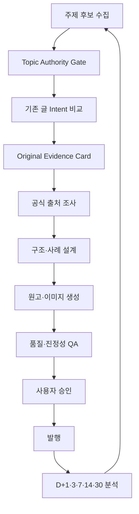

# 돈살림표 Harness 콘텐츠 품질 강화 구현계획

- 문서 버전: v1.0
- 작성일: 2026-10-28
- 적용 대상: 네이버 블로그 `돈살림표` 콘텐츠 기획·조사·작성·검수·발행·성과분석 Harness
- 핵심 주제: 직장인 가족의 세금·연금·지원금·가계 절감
- 목적: AI 대량생산이 아니라 **직접 경험·고유 분석·공식 근거가 있는 검색 친화적 콘텐츠**를 안정적으로 생산한다.

---

## 1. 결론

이번 개선에서 가장 중요한 것은 `직접 경험한 지식`을 Harness의 필수 입력과 발행 조건으로 바꾸는 것이다.

다만 실제 경험이 없는 세금·연금·지원금 주제에서 경험을 조작하면 안 된다. 따라서 Harness는 다음 세 가지 중 하나 이상의 고유 근거를 확보한 뒤에만 원고 생성을 시작해야 한다.

1. `REAL_EXPERIENCE`: 운영자가 실제로 경험한 문제·과정·실패·판단
2. `VERIFIED_SIMULATION`: 입력값과 계산 근거가 명시된 가상 사례
3. `PRIMARY_SOURCE_ANALYSIS`: 공식자료를 교차 검증해 독자의 행동으로 변환한 분석

핵심 운영 원칙은 다음과 같다.

> 경험·계산·공식자료 분석 중 하나 이상의 고유 근거가 없으면 원고 생성을 시작하지 않는다.

Harness 강화 순서는 다음과 같다.

```text
고유 근거 확보
→ 주제 적합성 판정
→ 기존 글과 검색 의도 중복 판정
→ 공식 출처 검증
→ 모바일 가독성 구조화
→ 최신성 기한 부여
→ 발행 후 실제 유입 데이터 피드백
```

---

## 2. 개선 배경

네이버가 안내한 좋은 콘텐츠의 핵심은 다음 다섯 가지다.

1. 직접 경험한 지식
2. 일관된 주제
3. 거짓 없는 진정성
4. 읽기 쉬운 구조
5. 최신성 유지

돈살림표의 현재 자동화는 주제 클러스터, 표, FAQ, 이미지, 출처 수집에는 강점이 있다. 반면 다음 두 지점은 별도 시스템화가 필요하다.

- 운영자의 실제 맥락과 고유 판단을 원고에 넣는 입력 단계
- 발행 후 검색 유입 데이터를 다음 주제와 기존 글 개선에 반영하는 단계

AI 사용 자체를 숨기거나 탐지를 피하는 것은 목표가 아니다. 최종 결과물이 독자에게 실질적인 도움을 주고, 근거가 있으며, 다른 글을 복제하지 않는 것이 목표다.

---

## 3. 목표와 비목표

### 3.1 목표

- AI가 경험을 지어내지 못하도록 차단한다.
- 모든 고위험 정보에 공식 출처와 확인 기준일을 연결한다.
- 기존 글과 의도가 겹치면 신규 생성보다 업데이트를 우선한다.
- 돈살림표의 핵심 독자와 주제 일관성을 유지한다.
- 모바일에서 결론·표·사례·FAQ를 쉽게 소비하도록 한다.
- 변경 가능성이 큰 정보에 재검토 일정을 자동 부여한다.
- 크리에이터 어드바이저 데이터를 이용해 주제 선정과 개선을 반복한다.
- 네이버 검색과 AI 브리핑에서 인용하기 쉬운 명확한 답변 구조를 만든다.

### 3.2 비목표

- 검색 순위 조작
- 키워드 반복 삽입
- 허위 체험담 생성
- 블로그와 무관한 실시간 인기 검색어 추격
- 비공식 자동 로그인·스크래핑을 이용한 네이버 데이터 수집
- 사람의 승인 없이 네이버 블로그에 자동 발행
- 애드포스트 클릭 또는 비정상 트래픽 유도

---

## 4. 돈살림표 콘텐츠 운영 정책

### 4.1 핵심 독자 정의

```yaml
audience:
  primary: "세금·연금·지원금과 가계비를 줄이고 싶은 30~50대 직장인 가족"
  situations:
    - 연말정산에서 공제 가능 여부가 헷갈리는 직장인
    - 부모·배우자·자녀 관련 지원금과 소득 기준을 확인하려는 가정
    - 국민연금·건강보험·고용보험 변화가 월급에 미치는 영향을 알고 싶은 직장인
    - 신청 대상·금액·기간·절차를 빠르게 확인하려는 사용자
```

### 4.2 콘텐츠 비율

초기 성장 단계의 기본 비율은 다음과 같다.

```yaml
content_mix:
  core_cluster: 70
  related_trend: 25
  experiment: 5
```

- `core_cluster`: 세금·연말정산·연금·보험·정부지원금
- `related_trend`: 크리에이터 어드바이저에서 발견한 핵심 독자 관련 단기 검색어
- `experiment`: 교육비·주거비·통신비 등 인접한 돈 문제

특정 핵심 클러스터를 집중 구축하는 기간에는 `80:20:0`까지 허용한다.

### 4.3 카테고리 생성 규칙

- 한 편의 글 때문에 새 카테고리를 만들지 않는다.
- 최소 5편 이상 지속 작성 계획이 있을 때만 카테고리를 생성한다.
- 메뉴 카테고리보다 검색 의도와 독자 일관성을 우선한다.
- 무관한 연예·스포츠·사건·일반 여행·일반 맛집 키워드는 검색량과 관계없이 제외한다.

---

## 5. 목표 파이프라인



### 필수 상태값

```yaml
status:
  - IDEA
  - TOPIC_REVIEW
  - UPDATE_EXISTING
  - EXPAND_HUB
  - CREATE_SUPPORTING_POST
  - CREATE_NEW
  - EVIDENCE_REQUIRED
  - RESEARCH
  - DRAFT
  - QA_BLOCKED
  - READY_FOR_APPROVAL
  - APPROVED
  - PUBLISHED
  - MONITORING
  - REFRESH_REQUIRED
  - MERGE_REQUIRED
  - RETIRED
```

---

## 6. P0-1: Original Evidence Layer

### 6.1 목적

AI가 인터넷에 있는 정보를 다시 요약하는 데 그치지 않고, 돈살림표에서만 제공할 수 있는 고유한 가치가 원고에 포함되도록 한다.

### 6.2 데이터 스키마

```yaml
original_evidence:
  evidence_mode: REAL_EXPERIENCE | VERIFIED_SIMULATION | PRIMARY_SOURCE_ANALYSIS
  reader_problem: ""
  author_context: ""
  actual_question: ""
  confusion_point: ""
  decision_process: []
  failed_attempt: ""
  calculation:
    inputs: {}
    formula: ""
    result: ""
    assumptions: []
  practical_tip: ""
  author_opinion: ""
  evidence_files: []
  safe_to_publish: false
```

### 6.3 모드별 처리

#### REAL_EXPERIENCE

실제 입력된 경험만 사용한다.

- 신청 또는 확인 과정
- 실제로 헷갈린 조건
- 실패·보완 과정
- 회사 시스템이나 공공기관 화면에서 확인한 항목
- 결과와 한계

사용자가 제공하지 않은 사실은 보완 생성하지 않는다.

#### VERIFIED_SIMULATION

실제 경험이 없을 때 사용한다.

필수 조건:

- `가상 사례` 또는 `계산 예시`라고 명확히 표시
- 입력값·공식·가정·결과를 모두 노출
- 독자가 자신의 값으로 바꿔 계산할 수 있게 설명
- 법률·세무상 개인별 차이가 있으면 별도 안내

예시:

> 다음은 이해를 돕기 위한 가상 사례입니다. 연봉 6,000만원인 직장인이 국민연금 월 50만원을 받는 부모님을 부양한다고 가정했습니다.

#### PRIMARY_SOURCE_ANALYSIS

경험과 계산만으로 설명하기 어려운 제도 글에 사용한다.

- 여러 공식자료의 조건을 하나의 판단표로 통합
- 변경 전후 비교
- 가능·불가능·추가 확인 필요로 구분
- 독자가 해야 할 다음 행동을 제시
- 어려운 공식 문장을 쉬운 표현으로 번역

### 6.4 허위 경험 차단 규칙

다음 표현은 실제 근거가 없으면 생성 금지한다.

```text
저도 직접 신청해봤는데요
제가 연말정산하면서 알게 된 사실입니다
실제로 환급받았습니다
회사 담당자에게 확인해보니
직접 사용해본 결과
세무서에 문의해보니
```

근거가 없을 때 허용되는 표현:

```text
국세청 공식 안내를 기준으로 확인하면
직장인 가족의 가상 사례로 계산하면
공식자료에서 가장 혼동하기 쉬운 부분은
다음 계산은 이해를 돕기 위한 예시이며 개인별 결과는 달라질 수 있습니다
```

### 6.5 차단 조건

- 고유 근거 모드가 선택되지 않음
- REAL_EXPERIENCE인데 원본 입력이 없음
- 가상 사례를 실제 사례처럼 서술함
- 계산 공식이나 가정이 없음
- 공식자료 분석인데 1차 출처가 없음

위 조건 중 하나라도 해당하면 `EVIDENCE_REQUIRED`로 전환하고 원고 생성을 중단한다.

---

## 7. P0-2: Topic Authority Gate

### 7.1 점수표

| 항목 | 배점 |
|---|---:|
| 직장인 가족의 돈 문제인가 | 30 |
| 세금·연금·지원금과 직접 연결되는가 | 25 |
| 기존 클러스터에 내부 링크가 가능한가 | 20 |
| 공식 근거를 확보할 수 있는가 | 15 |
| 돈살림표만의 사례·표·판단 기준을 만들 수 있는가 | 10 |

### 7.2 판정

```yaml
topic_decision:
  score: 0
  content_type: core_cluster | related_trend | experiment | reject
  target_reader: ""
  reader_question: ""
  cluster_id: ""
  suggested_internal_links: []
  decision: ACCEPT | HOLD | REJECT
```

- 75점 이상: 작성 가능
- 60~74점: 인접 주제로 월 발행량의 5% 이내에서 실험
- 60점 미만: 작성 금지

### 7.3 크리에이터 어드바이저 후보 처리

인기 검색어는 다음 순서로 필터링한다.

1. 돈살림표 핵심 독자와 관련되는가
2. 신청·발표·지급·개정 일정이 있는가
3. 공식자료가 존재하는가
4. 현재 상위 결과에서 빠진 답이 있는가
5. 기존 허브 또는 지원 글로 연결할 수 있는가

검색량이 높다는 이유만으로 `ACCEPT`하지 않는다.

---

## 8. P0-3: 검색 의도 중복 판정

### 8.1 목적

문장 유사도가 아니라 검색자의 질문과 기대 답변의 중복을 판정한다.

### 8.2 스키마

```yaml
intent_check:
  target_query: ""
  reader_question: ""
  expected_answer: ""
  target_stage: awareness | eligibility | calculation | application | troubleshooting
  existing_matches:
    - post_id: ""
      title: ""
      intent_overlap: 0.0
      missing_value: ""
  recommended_action: UPDATE_EXISTING | EXPAND_HUB | CREATE_SUPPORTING_POST | CREATE_NEW | REJECT
  reason: ""
```

### 8.3 라우팅 규칙

- 의도 중복 0.75 이상: `UPDATE_EXISTING`
- 기존 허브의 일부 답변으로 충분: `EXPAND_HUB`
- 독립된 구체적 질문이며 사례·표가 충분: `CREATE_SUPPORTING_POST`
- 기존 글과 다른 독립 검색 의도: `CREATE_NEW`
- 블로그 정체성과 무관: `REJECT`

### 8.4 금지사항

- 제목 단어만 바꾼 유사 글 생성
- 연도만 바꿔 신규 글 생성
- 동일 표와 FAQ를 여러 글에 반복
- 기존 글의 70% 이상을 재사용한 신규 원고

---

## 9. P0-4: Source & Truth Ledger

### 9.1 스키마

```yaml
claim:
  claim_id: ""
  text: ""
  risk_level: HIGH | MEDIUM | LOW
  source_type: PRIMARY | SECONDARY
  source_url: ""
  publisher: ""
  published_date: ""
  effective_date: ""
  checked_at: ""
  quoted_evidence: ""
  interpretation: ""
  expires_at: ""
  verification_status: VERIFIED | CONFLICT | UNVERIFIED
```

### 9.2 고위험 정보

다음 항목은 `HIGH`로 분류한다.

- 소득·재산·연령 기준
- 세율·공제율·한도·지원 금액
- 신청·지급·신고 기한
- 대상 제외 조건
- 법 시행일
- 제출 서류
- 잘못 안내할 경우 금전 손실이 생길 수 있는 내용

### 9.3 출처 정책

1차 출처 우선순위:

1. 법령·고시·공식 공고
2. 국세청·정부24·복지로·국민연금공단·건강보험공단 등 담당 기관
3. 중앙부처·지방자치단체 공식 안내
4. 공식 보도자료·FAQ
5. 신뢰 가능한 2차 해설

규칙:

- HIGH 주장에는 PRIMARY 출처가 없으면 발행 차단
- 시행일과 게시일을 분리 저장
- 공식자료가 충돌하면 담당 기관의 최신 원문을 우선
- 불확실한 내용은 단정하지 않고 `추가 확인 필요`로 표시
- 본문 하단에 출처명·링크·확인 기준일을 제공
- 외부 글을 인용하면 원문 링크를 표시

---

## 10. P1-1: 표준 원고 구조

모든 글이 같은 문장으로 보이지 않도록 표현은 다양화하되 정보 접근 순서는 유지한다.

### 10.1 기본 구조

1. 검색자의 질문을 한 문장으로 확인
2. `핵심만 먼저 보기`
3. 대상·금액·기간·결론 표
4. 가장 중요한 결론과 예외
5. 조건별 상세 설명
6. 직장인 가족 실제 또는 가상 계산 사례
7. 신청·확인·수정 절차
8. 실패하기 쉬운 지점과 해결 방법
9. 관련 허브·지원 글 내부 링크
10. 자주 묻는 질문 3~5개
11. 공식 출처와 확인 기준일

### 10.2 모바일 가독성 규칙

- 첫 화면 안에 결론 또는 핵심 요약 배치
- 문단당 2~4문장
- 한 문단에는 한 가지 주장
- 소제목만 읽어도 전체 흐름이 이해되도록 작성
- 가로 스크롤이 필요한 넓은 표 금지
- 표의 열은 모바일 기준 최대 3열 권장
- 동일한 결론 반복 금지
- 의미 없는 인사말·일반론 도입 금지
- 중요한 정보는 이미지뿐 아니라 본문 텍스트에도 작성
- 숫자·날짜·단위의 표기 일관성 검사

### 10.3 FAQ 생성 규칙

FAQ는 본문의 문장을 질문형으로 다시 쓰지 않는다.

우선순위:

1. 제외 조건
2. 경계값
3. 중복 신청·중복 공제
4. 실제 처리 방법
5. 잘못 신청했을 때 수정 방법

---

## 11. P1-2: 이미지 품질 정책

### 11.1 글당 권장 이미지

| 이미지 | 권장 수량 | 목적 |
|---|---:|---|
| 대표 썸네일 | 1 | 검색·홈판 클릭 유도 |
| 핵심 요약 카드 | 1 | 대상·금액·기간·결론 |
| 계산 사례 또는 비교표 | 1 | 조건별 결과 이해 |
| 절차·체크리스트 | 1 | 실행 편의성 |
| 장식 이미지 | 0~1 | 긴 글의 호흡 조절 |

### 11.2 원칙

- AI 인물 이미지보다 계산표·판단표·체크리스트를 우선한다.
- 핵심 숫자는 이미지에만 두지 않는다.
- 모바일에서 읽을 수 없는 작은 글자 금지
- 본문 정보와 관계없는 이미지 나열 금지
- 같은 일러스트 구도를 여러 글에 반복하지 않는다.
- 캡처 이미지에 개인정보가 있으면 자동 마스킹 또는 발행 차단
- 공식 로고·화면을 사용할 때 출처와 이용 범위를 확인

### 11.3 이미지 QA 출력

```yaml
image_qa:
  information_value: 0
  mobile_legibility: 0
  brand_consistency: 0
  duplicate_visual_risk: 0
  contains_critical_text_only: false
  privacy_checked: false
  result: PASS | REVISE | BLOCK
```

---

## 12. P1-3: Freshness Scheduler

### 12.1 기본 주기

| 글 유형 | 기본 재검토 주기 |
|---|---:|
| 신청 일정·지급일 | 7~14일 |
| 세법·지원금 개정 | 30일 |
| 연말정산 시즌 글 | 시즌 중 14일, 평시 90일 |
| 연금·보험 기준 | 90일 |
| 일반 개념 설명 | 180일 |
| 공식 발표 대기 글 | 발표 당일 즉시 |

### 12.2 스키마

```yaml
freshness:
  volatility: HIGH | MEDIUM | LOW
  last_verified_at: ""
  next_review_at: ""
  watched_fields: []
  changed_fields: []
  update_action: KEEP | PATCH | MAJOR_UPDATE | NEW_POST | RETIRE
```

### 12.3 업데이트 정책

- 금액·일정만 변경: 기존 글 수정
- 검색 의도가 같고 제도만 변경: 기존 글 업데이트
- 제도 구조와 검색 의도가 모두 변경: 신규 글 작성 후 기존 글에서 연결
- 오래된 정보가 독자에게 금전 피해를 줄 수 있음: `URGENT_UPDATE`
- 기준일이 지난 신청 안내: 제목·본문·요약을 동시에 갱신

---

## 13. P1-4: 발행 전 품질 점수와 Release Gate

### 13.1 100점 평가표

| 평가 항목 | 점수 |
|---|---:|
| 고유한 경험·사례·분석 | 25 |
| 주제 적합성과 클러스터 연결 | 20 |
| 공식 출처와 사실 정확성 | 20 |
| 검색 의도 충족 | 15 |
| 모바일 가독성 | 10 |
| 최신성 | 10 |

### 13.2 판정

- 85점 이상: `READY_FOR_APPROVAL`
- 75~84점: `REVISION_REQUIRED`
- 75점 미만: `QA_BLOCKED`

### 13.3 점수와 무관한 Hard Block

- 실제 경험 조작
- 고위험 정보에 1차 출처 없음
- 기존 글과 검색 의도가 75% 이상 중복되는데 신규 글로 생성
- 제목과 본문 결론 불일치
- 확인 기준일 누락
- 핵심 정보가 이미지에만 존재
- 블로그와 무관한 인기 키워드 삽입
- 협찬·광고·제휴 고지 누락
- 비정상 트래픽 또는 광고 클릭 유도 문구
- 법률·세무·금융 결과를 확정적으로 보장

### 13.4 QA 결과 형식

```yaml
release_gate:
  total_score: 0
  sub_scores:
    originality: 0
    topic_authority: 0
    source_integrity: 0
    search_intent: 0
    readability: 0
    freshness: 0
  hard_blocks: []
  warnings: []
  required_fixes: []
  final_status: PASS | REVISE | BLOCK
```

---

## 14. P2: 크리에이터 어드바이저 피드백 루프

### 14.1 수집 정책

- 공식 API가 없는 경우 자동 로그인·스크래핑하지 않는다.
- 주 1회 사용자가 입력한 값, CSV 또는 개인정보를 제거한 캡처를 사용한다.
- 데이터가 없으면 추정치를 사실처럼 기록하지 않는다.

### 14.2 발행 후 점검

| 시점 | 점검 항목 | Harness 조치 |
|---|---|---|
| D+1 | 검색 반영 여부 | 색인·공개 상태 확인 |
| D+3 | 실제 유입 검색어 | 목표 검색 의도와 비교 |
| D+7 | 조회수·검색 유입·메인 유입 | 제목·첫 화면·썸네일 개선 |
| D+14 | 파생 검색어·관련 글 이동 | 후속 지원 글 및 내부 링크 제안 |
| D+30 | 누적 성과·유입 지속성 | 유지·수정·통합·종료 결정 |

### 14.3 성과 판정 규칙

```yaml
performance_review:
  post_id: ""
  target_query: ""
  actual_queries: []
  pageviews: 0
  search_inflow: 0
  main_inflow: 0
  engagement_signals: {}
  decision: KEEP | TITLE_TEST | INTRO_REWRITE | EXPAND | CREATE_SUPPORTING_POST | MERGE | RETIRE
  next_action_due: ""
```

- 목표 검색어 유입과 조회가 함께 증가: 해당 클러스터 확장
- 검색 유입은 있으나 클릭이 약한 것으로 추정: 제목·대표 이미지 점검
- 유입은 있으나 관련 글 이동이 약함: 내부 링크와 다음 행동 개선
- 예상하지 못한 검색어로 유입: 별도 검색 의도인지 검토
- 30일간 의미 있는 유입이 없음: 허브 통합 또는 전면 개편
- 단기 키워드 유입 종료: 최신 정보로 갱신하거나 허브로 흡수

---

## 15. AI 브리핑 대응 구조

AI 브리핑 인용만을 위한 조작을 하지 않는다. 다만 기계와 사람 모두 이해하기 쉽게 다음 구조를 적용한다.

- 질문 직후 한 문장 답변
- 대상·조건·금액·기간을 텍스트 표로 제공
- 가능·불가능·추가 확인 필요를 명확히 구분
- 계산 가정과 결과를 분리
- 예외 조건을 본문에 명시
- 공식 출처와 기준일 제공
- 이미지 안의 핵심 내용을 본문 텍스트로도 제공
- FAQ는 실제 경계 사례 중심으로 구성

---

## 16. 역할별 책임

### Topic Agent

- 크리에이터 어드바이저·계절성·기존 클러스터에서 후보 수집
- Topic Authority 점수 계산
- 기존 글과 의도 비교

### Evidence Agent

- Original Evidence Card 생성
- 경험 여부를 명확히 분류
- 가상 사례 입력값과 공식을 검증

### Research Agent

- 공식 출처 우선 조사
- Source & Truth Ledger 작성
- 날짜·금액·시행일 충돌 탐지

### Writer Agent

- 표준 구조에 맞춰 원고 작성
- 근거 없는 경험·감정·결과를 생성하지 않음
- 독자 행동과 예외 조건을 명확히 작성

### Visual Agent

- 정보성 이미지 기획
- 모바일 가독성·개인정보·중복 디자인 점검

### QA Agent

- 점수 평가와 Hard Block 수행
- Writer Agent와 분리하여 독립 검수
- 근거 없는 문장을 Source Ledger와 대조

### Performance Agent

- D+1·3·7·14·30 데이터를 기록
- 신규 글보다 기존 글 수정이 유리한 경우 업데이트 제안

---

## 17. 구현 우선순위

### Sprint 1 — P0, 즉시 구현

1. Original Evidence Card
2. 허위 경험 탐지 및 차단
3. Topic Authority Gate
4. 검색 의도 중복 판정
5. Source & Truth Ledger
6. Hard Block Release Gate

완료 조건:

- 경험 입력이 없는 글에서 1인칭 체험 표현이 생성되지 않는다.
- HIGH 주장 100%가 공식 출처와 연결된다.
- 기존 글과 의도 중복 시 신규 생성 대신 업데이트가 제안된다.
- 주제 무관 인기 키워드가 차단된다.

### Sprint 2 — P1

1. 핵심만 먼저 보기 구조
2. 계산 사례 생성기
3. 모바일 표·문단 QA
4. 이미지 정보성 QA
5. Freshness Scheduler
6. 100점 품질 평가표

완료 조건:

- 첫 화면에 핵심 답변이 존재한다.
- 가상 사례에 입력값·공식·가정이 표시된다.
- 핵심 정보가 이미지에만 존재하지 않는다.
- 모든 글에 다음 재검토일이 부여된다.

### Sprint 3 — P2

1. 크리에이터 어드바이저 수동 입력 폼
2. D+1·3·7·14·30 성과 기록
3. 성과 기반 후속 글 추천
4. 업데이트·통합 우선순위 보드
5. AI 브리핑 인용 점검표

완료 조건:

- 발행한 모든 글에 성과 점검 일정이 자동 생성된다.
- 신규 주제 추천에 실제 유입 검색어가 반영된다.
- 유입 없는 글이 계속 방치되지 않고 수정·통합 큐로 이동한다.

---

## 18. 필수 테스트 시나리오

### Test 1: 실제 경험 조작 방지

입력:

```yaml
topic: "근로장려금 신청 후기"
actual_experience: null
```

기대 결과:

- `REAL_EXPERIENCE` 선택 불가
- `VERIFIED_SIMULATION` 또는 `PRIMARY_SOURCE_ANALYSIS` 제안
- “직접 신청해봤다”는 문장 생성 금지

### Test 2: 가상 사례 표시

입력:

```yaml
topic: "연금 받는 부모님 부양가족 공제"
case:
  pension_monthly: 500000
  other_income: 0
```

기대 결과:

- 가상 사례임을 명시
- 연간 환산값·적용 기준·가정을 표시
- 공식 기준과 연결

### Test 3: 기존 글 중복

입력:

```yaml
existing_post: "연말정산 부양가족 소득 100만원 기준"
new_topic: "부양가족 소득이 100만원 넘으면 어떻게 될까"
```

기대 결과:

- `UPDATE_EXISTING`
- 신규 글 생성 금지

### Test 4: 인기 있지만 무관한 키워드

입력:

```yaml
creator_advisor_keyword: "인기 드라마 결말"
```

기대 결과:

- Topic Authority 60점 미만
- `REJECT`

### Test 5: 공식 근거 없는 금액

입력:

```yaml
claim: "2027년 부모급여는 월 150만원이다"
primary_source: null
```

기대 결과:

- HIGH 위험 주장
- `UNVERIFIED`
- 발행 차단

### Test 6: 최신성 만료

입력:

```yaml
post_type: "지원금 신청 일정"
last_verified_at: "2026-09-01"
```

기대 결과:

- `REFRESH_REQUIRED` 또는 `URGENT_UPDATE`
- 최신 공식 일정을 확인하기 전 재발행 금지

### Test 7: 이미지에만 핵심 정보 존재

입력:

```yaml
body_text_contains_amount: false
summary_image_contains_amount: true
```

기대 결과:

- `contains_critical_text_only: true`
- 본문 텍스트 보완 전 발행 차단

---

## 19. 운영 KPI

초기 KPI는 조회수만 보지 않고 품질과 학습 루프를 함께 측정한다.

### 품질 KPI

- HIGH 주장 공식 출처 연결률: 100%
- 허위 경험 탐지 누락: 0건
- 기준일 표기율: 100%
- 기존 글 중복 신규 발행률: 5% 미만
- 재검토 기한 지정률: 100%
- 핵심 정보 본문 텍스트 제공률: 100%

### 성장 KPI

- 검색 유입이 발생한 글 비율
- 글별 유입 검색어 수
- 클러스터별 누적 검색 유입
- 기존 글 업데이트 후 14일 성과 변화
- 관련 글 내부 이동 또는 복수 페이지 조회 지표
- AI 브리핑 인용 글 수와 인용 검색어 수
- 애드포스트 승인 후 글 유형별 광고 노출·클릭·예상수익

### 생산성 KPI

- 글 1편당 조사·작성·검수 시간
- QA 수정 왕복 횟수
- 신규 작성 대비 기존 글 업데이트 비율
- 자동 차단으로 예방한 오류 건수

---

## 20. Harness 실행 지시문

다음 지침은 모든 돈살림표 콘텐츠 작업의 상위 규칙으로 적용한다.

```text
너는 돈살림표 네이버 블로그 콘텐츠 Harness다.

목표는 글을 많이 만드는 것이 아니라 직장인 가족에게 정확하고 실질적인 도움을 주는 세금·연금·지원금 콘텐츠를 만드는 것이다.

원고를 생성하기 전에 반드시 다음을 수행한다.

1. 주제가 돈살림표 핵심 독자와 연결되는지 Topic Authority 점수로 평가한다.
2. 기존 글과 검색 의도를 비교하여 UPDATE_EXISTING, EXPAND_HUB, CREATE_SUPPORTING_POST, CREATE_NEW, REJECT 중 하나를 선택한다.
3. REAL_EXPERIENCE, VERIFIED_SIMULATION, PRIMARY_SOURCE_ANALYSIS 중 하나 이상의 Original Evidence를 확보한다.
4. 실제 경험이 입력되지 않았다면 체험한 것처럼 서술하지 않는다.
5. 금액·소득·연령·기한·제외 조건은 공식 1차 출처로 검증하고 Source & Truth Ledger에 저장한다.
6. 핵심만 먼저 보기, 요약표, 조건별 설명, 사례, 절차, 예외, FAQ, 공식 출처, 확인 기준일 순서로 원고를 구성한다.
7. 핵심 정보는 이미지에만 넣지 않고 본문 텍스트로도 제공한다.
8. 글 유형에 따라 다음 재검토일을 지정한다.
9. 품질 점수가 85점 미만이거나 Hard Block이 하나라도 있으면 발행 준비 상태로 전환하지 않는다.
10. 사람의 최종 승인 없이 네이버 블로그에 발행하지 않는다.

절대 금지:
- 허위 경험
- 출처 없는 고위험 정보
- 기존 글과 의도가 같은 신규 글
- 블로그와 무관한 인기 키워드
- 키워드 반복·숨김
- 광고 클릭 유도
- 결과 보장 표현
- 비공식 네이버 로그인 자동화와 무단 스크래핑

발행 후에는 D+1, D+3, D+7, D+14, D+30 성과를 기록하고 유지·수정·확장·통합·종료 중 하나를 결정한다.
```

---

## 21. 참고한 공식 원칙

- [네이버 서치어드바이저 — 콘텐츠 작성 시 권장 사항](https://searchadvisor.naver.com/guide/content-basic)
- [네이버 검색 고객센터 — 블로그 검색 노출 순서](https://help.naver.com/service/5593/contents/10582)
- [네이버 검색 고객센터 — 블로그 검색 제한 기준](https://help.naver.com/service/5626/bookmark/22928)
- [네이버 서치어드바이저 — 웹 콘텐츠 스팸 사례](https://searchadvisor.naver.com/guide/content-abusing)
- [네이버 Creator Advisor 고객센터](https://help.naver.com/service/23038/contents/19001)

---

## 22. 최종 구현 판단

이 개선의 성공 기준은 AI 문장이 더 자연스러워지는 것이 아니다.

성공한 Harness는 다음을 수행해야 한다.

- 경험이 없으면 경험을 만들지 않는다.
- 사실이 불확실하면 발행하지 않는다.
- 같은 질문의 글이 있으면 새로 쓰기보다 개선한다.
- 인기 검색어라도 돈살림표 독자와 무관하면 거절한다.
- 변경 가능성이 있는 정보는 자동으로 다시 확인한다.
- 발행 후 실제 검색 유입을 다음 결정에 사용한다.

즉, 돈살림표 Harness는 `자동 글 생성기`가 아니라 **고유 근거와 검색 성과를 축적하는 콘텐츠 품질 운영 시스템**으로 발전해야 한다.
